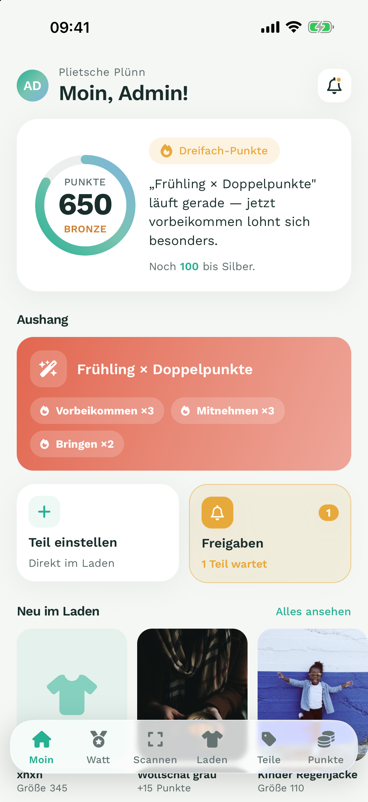
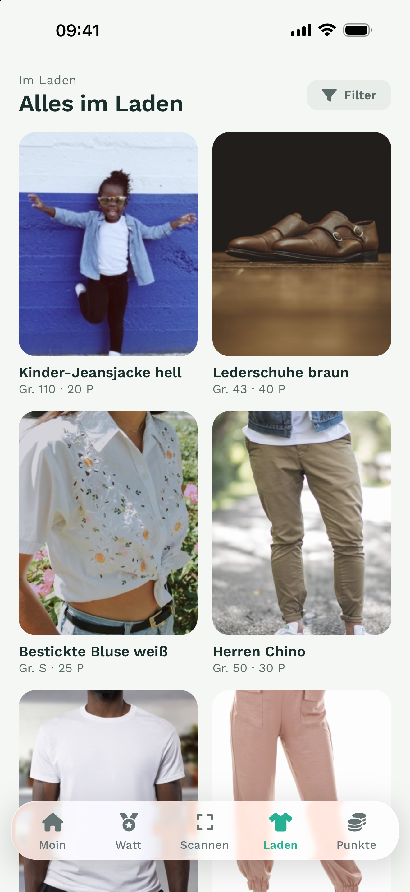
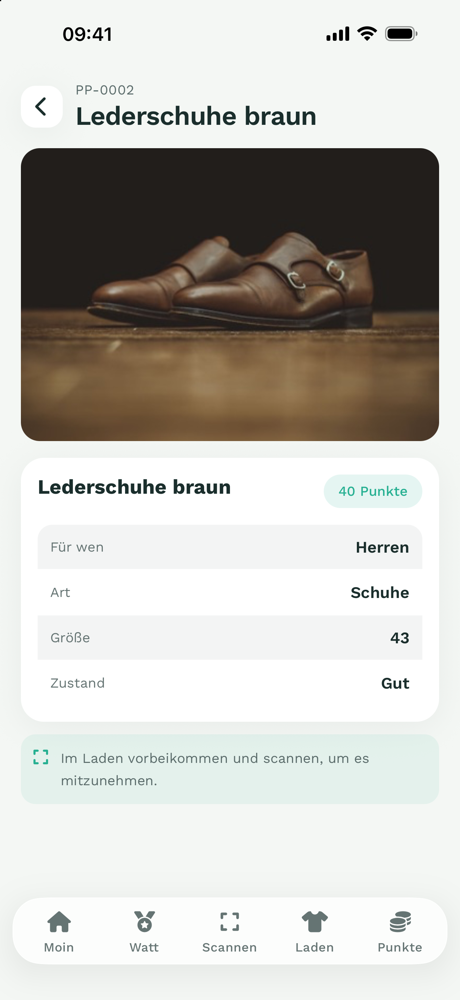
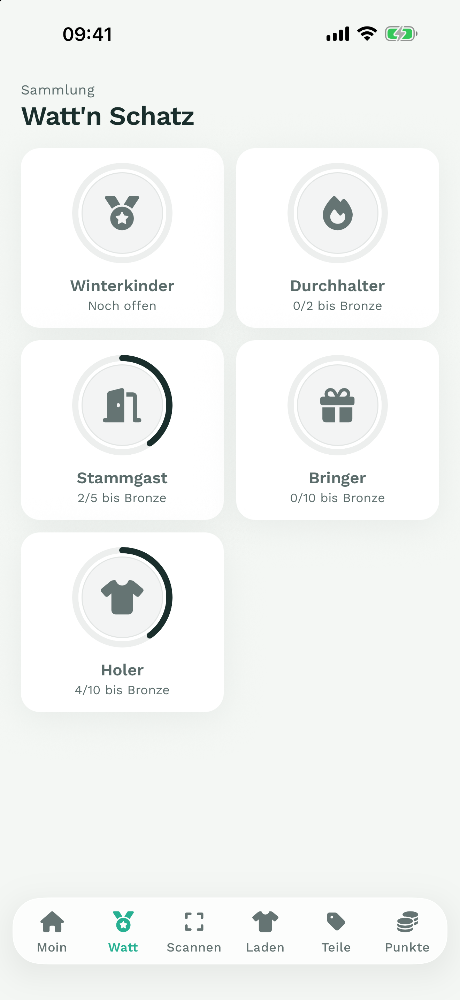

<p align="center">
  
</p>

<h1 align="center">Plietsche Plünn</h1>

<p align="center">
  Die App für den Kleidertausch-Laden —<br>
  vorbeikommen, mitnehmen, bringen und dafür Punkte sammeln.
</p>

<p align="center">
  
  
  
  
</p>

## Worum es geht

Ein Kleidertausch-Laden lebt davon, dass Menschen wiederkommen — und dass sie
nicht nur nehmen, sondern auch bringen. Die App macht genau das sichtbar: Jeder
Besuch, jedes mitgenommene und jedes gebrachte Teil zählt Punkte. Aus Punkten
werden Ränge, aus Regelmäßigkeit werden Abzeichen.

Das Team verwaltet den Bestand, prüft eingereichte Teile und fährt Aktionen, in
denen einzelne Handlungen mehr zählen. Die Daten liegen auf einem selbst
betriebenen Server; es gibt keinen Cloud-Dienst dazwischen.

## Funktionen

### Für Besucher:innen

- **Check-in per QR-Code** — ein Scan an der Ladentür, ein Besuch gezählt; auf
  Wunsch prüft die App, ob man wirklich vor Ort ist
- **Teile mitnehmen** — Code am Kleidungsstück scannen oder die Anzahl eintragen
- **Punkte, Ränge, Abzeichen** — Fortschritt als Ring, Abzeichen in Stufen von
  Bronze bis Diamant, Punkteverlauf nach Tagen
- **Im Laden stöbern** — alle verfügbaren Teile mit Foto, Größe und Punktwert,
  Filter nach Zielgruppe, Art, Größe und „Neu“; dazu das Schaufenster des Teams
- **Teile einreichen** — Foto, Größe und Zustand; nach der Freigabe gibt es Punkte
- **Teilen, empfehlen, bewerten** — Teile per Teilen-Menü weitergeben
- **Mitteilungen nach Wahl** — vier Arten, jede einzeln abschaltbar
- **Konto selbst verwalten** — Passwort zurücksetzen, Konto löschen

### Für das Team

- **Freigaben** — eingereichte Teile prüfen, bearbeiten, ins Schaufenster heben
- **Inventar** — alle Teile mit Status, Filtern und Etikettendruck
- **Aushang** — Ankündigungen mit Vorlagen und optionaler Sofort-Mitteilung

### Für die Leitung

- **Aktionen** — Zeitraum und getrennte Faktoren für Vorbeikommen, Mitnehmen und
  Bringen, auf Wunsch nur für bestimmte Gruppen
- **Punkte und Ränge** — Punktwerte, Höchstzahl je Besuch und Rangleiter frei
  einstellbar
- **Abzeichen** — eigene Stufen, Auslöser, Schwellen und Boni

## Installation

**[Im App Store laden »](https://apps.apple.com/app/id6784690448)** ·
**[Bei Google Play »](https://play.google.com/store/apps/details?id=de.godsapp.plietschepluenn)**

Die App gehört zu einem bestimmten Laden: Nach dem Start legt man ein Konto an
und checkt beim nächsten Besuch an der Tür ein. Wer einen eigenen Laden damit
betreiben will, braucht einen eigenen Server, siehe
[Selbst betreiben](#selbst-betreiben).

## Bildschirmfotos

| Start | Laden | Teil | Abzeichen |
|-------|-------|------|-----------|
|  |  |  |  |

## Versionen

Was sich wann geändert hat, steht in [CHANGELOG.md](CHANGELOG.md) — aus Sicht
der Nutzer:innen geschrieben.

## Selbst betreiben

Das Backend ist [PocketBase](https://pocketbase.io) mit eigenen Hooks und
Migrationen. Nötig sind Docker und für die App Node 22.

**1. Backend starten.** Hooks und Migrationen werden beim Start eingelesen, das
Schema legt sich selbst an. PocketBase verschlüsselt seine Einstellungen mit
einem Schlüssel aus genau 32 Zeichen.

```bash
git clone https://github.com/Revisor01/plietsche-pluenn.git
cd plietsche-pluenn
echo "PB_ENCRYPTION_KEY=$(openssl rand -hex 16)" > .env
docker compose up -d
# Probe: curl http://localhost:8090/api/health
```

Den Schlüssel in `.env` aufheben: Ohne ihn lassen sich die gespeicherten Einstellungen
nach einem Neustart nicht mehr lesen.

**2. Verwaltung einrichten.** Beim ersten Start schreibt PocketBase einen Link
zum Anlegen des Superuser-Kontos ins Log (`docker compose logs pocketbase`). Unter
`http://localhost:8090/_/` lassen sich danach im Datensatz `store`
Öffnungszeiten, Adresse und Standort des Ladens pflegen und im Datensatz
`users` einem Konto die Rolle `volunteer` (Team) oder `admin` (Leitung) geben.

**3. App starten.** Die App spricht den Server an, den `EXPO_PUBLIC_PB_URL`
nennt; ohne die Variable kommt keine Anmeldung zustande (Vorlage:
`mobile/.env.example`). Ein Handy im selben Netz erreicht den Rechner über
seine lokale Adresse.

```bash
cd mobile
npm install --legacy-peer-deps
EXPO_PUBLIC_PB_URL=http://<adresse-des-rechners>:8090 npx expo start
```

Mitteilungen laufen über den Push-Dienst von Expo und brauchen ein eigenes
Expo-Projekt mit Zugangsdaten für Apple und Google; ohne sie funktioniert alles
andere, es wird nur nichts zugestellt.

**Tests.** `npm test` im Wurzelverzeichnis prüft die Hooks;
`npm run test:integration` lädt eine echte PocketBase herunter und prüft
Migrationen und Zugriffsregeln gegen sie.

## Aufbau

```
plietsche-pluenn
├── mobile/              — die App (Expo / React Native, TypeScript)
│   ├── app/             — Bildschirme, dateibasiertes Routing
│   ├── components/      — Bausteine, Tab-Leiste, Scanner
│   └── lib/             — Design-Tokens, API, Hooks, Mitteilungen
├── pocketbase/
│   ├── pb_hooks/        — Scanner, Punkte- und Abzeichenlogik, Versand, Zeitpläne
│   ├── pb_migrations/   — Schema und Startdaten
│   └── Dockerfile       — Abbild mit Hooks und Migrationen
├── tests/               — Hook-Tests und Integrationstests
├── web/                 — Landingpage
├── design/              — Gestaltung und Store-Bilder
└── docs/                — API (openapi.yaml), Mitteilungs-Kanäle
```

Technischer Steckbrief mit Versionen, Datenmodell und Berechtigungen:
[TECH.md](TECH.md). Die API beschreibt [docs/openapi.yaml](docs/openapi.yaml).

**Worauf es beim Bauen ankommt:**
- **Die Wahrheit liegt auf dem Server.** Punktestand, Serie und Rolle sind gegen
  Schreibzugriffe aus der App geschützt; die App zeigt an, sie rechnet nicht.
- **Das Punktekonto heilt sich selbst.** Der Stand wird nach jeder Buchung aus
  dem vollständigen Journal neu summiert und kann nicht abdriften.
- **Datenschutz durch das Datenmodell.** Ein mitgenommenes Teil speichert keinen
  Verweis auf die Person; „Person X nahm Teil Y“ gibt es in der Datenbank nicht.
- **Zwei Designsprachen, eine Codebasis.** iOS folgt Apples Gestaltungsregeln,
  Android Material 3; Farben, Schrift und Aufbau sind gleich.
- **Ausgelieferte Apps nie brechen.** Versionen in den Stores lesen die API mit;
  Antwortformen ändern sich nur additiv (siehe [CLAUDE.md](CLAUDE.md)).

## Mitmachen

Fehlermeldungen und Vorschläge sind willkommen — gern als
[Issue](https://github.com/Revisor01/plietsche-pluenn/issues). Sicherheitslücken
bitte vertraulich melden, wie in [SECURITY.md](SECURITY.md) beschrieben. Pull
Requests laufen durch Tests und einen Secret-Scan; die Grundsätze für Beiträge
stehen in [CONTRIBUTING.md](CONTRIBUTING.md).

## Datenschutz

Keine Analysewerkzeuge, keine Werbung, keine Absturzberichte an Dritte. Die App
spricht nur mit dem Server des Ladens und, für Mitteilungen, mit dem Push-Dienst
von Expo. Gespeichert werden Konto, Punkte, Besuche und eingereichte Teile; beim
Check-in nur der Abstand zum Laden, nicht der Standort. Anmeldedaten liegen im
Schlüsselbund des Geräts.

Die vollständige Erklärung steht unter
[simonluthe.de/apps/plietschepluenn/datenschutz](https://simonluthe.de/apps/plietschepluenn/datenschutz/).

## Lizenz

Plietsche Plünn steht unter der
[GNU Affero General Public License v3.0](LICENSE): Wer App oder Backend für
andere betreibt, legt auch seine Änderungen offen. Für Beiträge gilt
[CONTRIBUTING.md](CONTRIBUTING.md).

## Kontakt

Pastor Simon Luthe · [mail@simonluthe.de](mailto:mail@simonluthe.de) ·
[simonluthe.de](https://simonluthe.de)
